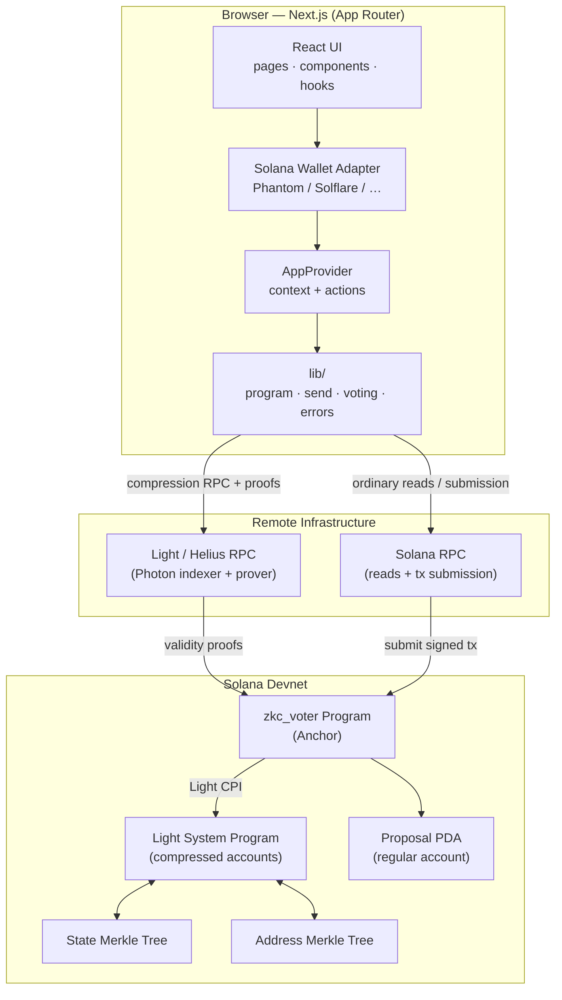
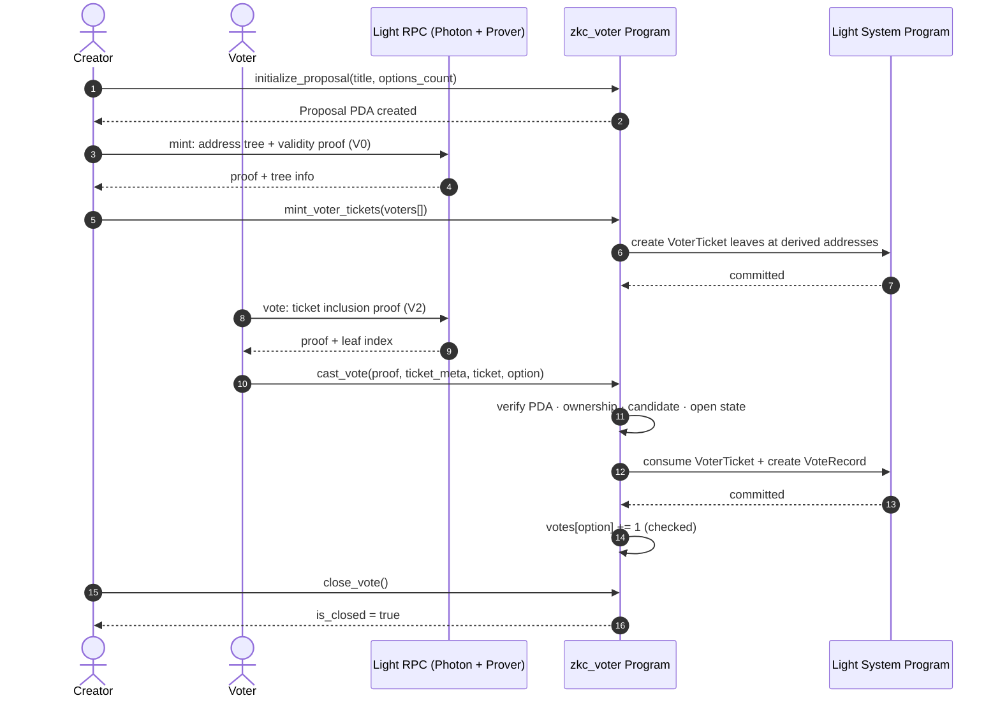

# ZKC Voter

**Privacy-preserving, Sybil-resistant on-chain voting on Solana, built with Light Protocol ZK Compression.**

ZKC Voter is a decentralized, permissioned voting application in which a proposal
creator mints a single, non-fungible ballot (a *Voter Ticket*) for each eligible
wallet, and each ticket holder casts exactly one vote. Ballots and ballot stubs
are stored as **compressed accounts** rather than ordinary Solana accounts,
which keeps per-voter storage costs near zero while preserving cryptographic
integrity through zero-knowledge validity proofs.

---

## Table of Contents

1. [Overview](#1-overview)
2. [Problem Statement](#2-problem-statement)
3. [Key Features](#3-key-features)
4. [Technology Stack](#4-technology-stack)
5. [Architecture](#5-architecture)
6. [On-chain Data Model](#6-on-chain-data-model)
7. [Protocol Flow](#7-protocol-flow)
8. [Security Model](#8-security-model)
9. [Design Choices & Rationale](#9-design-choices--rationale)
10. [Repository Structure](#10-repository-structure)
11. [Frontend Architecture](#11-frontend-architecture)
12. [Smart Contract Architecture](#12-smart-contract-architecture)
13. [Getting Started](#13-getting-started)
14. [Testing](#14-testing)
15. [Known Issues & Failures](#15-known-issues--failures)
16. [Successes](#16-successes)
17. [Expected Outcome](#17-expected-outcome)
18. [Roadmap](#18-roadmap)
19. [Contributing](#19-contributing)
20. [License](#20-license)
21. [Acknowledgments & Disclaimer](#21-acknowledgments--disclaimer)

---

## 1. Overview

ZKC Voter combines an [Anchor](https://www.anchor-lang.com/) program with the
[Light Protocol](https://www.lightprotocol.com/) ZK Compression SDK to implement
an election primitive with the following lifecycle:

1. A **creator** initializes a proposal with between 2 and 10 options.
2. The creator **mints** a deterministic, one-per-voter *Voter Ticket* as a
   compressed account for each authorized wallet.
3. Each ticket holder **casts a vote** by consuming their ticket and producing a
   *Vote Record* — a compressed receipt — while incrementing the on-chain tally.
4. The creator **closes** the proposal, freezing the result.

Because every ticket and receipt is a compressed account, the marginal cost of
enrolling one more voter is negligible, and the scheme is intrinsically resistant
to double-voting and ballot forgery: a ticket can only be spent once, only by its
named owner, and only for its designated proposal.

> **Status note.** Proposal creation, ticket minting, vote casting, and closure
> are all functional. The `cast_vote` flow was previously failing with
> `ProofVerificationFailed` (`0x179b`); the root cause was the client proof request
> using `getValidityProofV2` (which maps input accounts to bare hashes and produces
> a proof with empty input roots) instead of `getValidityProofV0` with V2 mode
> forced. See [Known Issues](#15-known-issues--failures) for the full diagnosis.

## 2. Problem Statement

Traditional on-chain voting systems face a number of recurring challenges:

- **Sybil resistance** — nothing prevents a single actor from voting with many
  wallets unless eligibility is enforced cryptographically.
- **Double-voting** — a naive tally can be inflated by re-submitting votes.
- **Storage cost** — storing a dedicated account per voter per election is
  prohibitively expensive at scale.
- **Ballot integrity** — results must not be forgeable or silently alterable.
- **Verifiability** — a third party should be able to verify that a result follows
  from the set of eligible ballots.

ZKC Voter addresses these by binding eligibility to a creator-issued, seed-derived
compressed ticket, spending that ticket atomically on vote, and recording the vote
as a compressed receipt — all enforced in a single Solana transaction.

## 3. Key Features

| Area | Capability |
| --- | --- |
| Eligibility | Creator-minted, one-per-wallet `VoterTicket` compressed accounts |
| Sybil resistance | Deterministic ticket address `[voter_ticket, proposal, voter]` prevents duplicate minting |
| Double-vote prevention | Ticket is *consumed* (nullified) on vote; a second spend is impossible |
| Ballot integrity | Vote `VoteRecord` is a compressed receipt committed to the address tree |
| Cost efficiency | Ballots and receipts live off the normal account store (ZK Compression) |
| Access control | Only the creator may mint or close; only the ticket owner may spend it |
| Safe arithmetic | All tally increments use checked arithmetic |
| Multi-wallet UX | Phantom, Solflare, Backpack, Coinbase, Glow, and Trust adapters |
| Defensive error layer | Raw Anchor/Light errors are translated to actionable user messages |

## 4. Technology Stack

### Smart Contract

| Dependency | Version | Purpose |
| --- | --- | --- |
| `anchor-lang` | 0.31.1 | Program framework, accounts, CPI, IDL generation |
| `light-sdk` | 0.23.0 (`anchor` feature) | ZK Compression CPI, compressed accounts, validity proofs |
| Rust | 2021 edition | Implementation language |

### Frontend

| Dependency | Version | Purpose |
| --- | --- | --- |
| Next.js | 14.2.15 (App Router) | React framework, routing, SSR/hydration |
| React | 18.3.1 | UI layer |
| TypeScript | 5.5 | Static typing |
| `@solana/web3.js` | 1.99 | Transactions, public keys, connections |
| `@coral-xyz/anchor` | 0.31.1 | Typed program client from the generated IDL |
| `@lightprotocol/stateless.js` | 0.23.3 | Client-side proof generation and compressed-account handling |
| `@solana/wallet-adapter-*` | see `package.json` | Wallet connectivity (Phantom, Solflare, Backpack, Coinbase, Glow, Trust) |

### Tooling & Testing

| Dependency | Purpose |
| --- | --- |
| Mocha / Chai / `ts-mocha` | TypeScript test runner and assertions |
| Prettier / ESLint | Formatting and linting |
| Anchor CLI | Build, deploy, IDL generation |
---

## 5. Architecture

The application is split across three tiers: a **browser client**, **remote RPC
infrastructure**, and the **Solana devnet program** (which in turn drives the
Light System Program for compressed-account operations).



### Component Responsibilities

- **React UI** — the routing and presentation layer. Three routes exist: the poll
  directory, the create-poll form, and the per-poll detail view.
- **Wallet Adapter** — a single abstraction over six wallet providers; it supplies
  the signing key and `sendTransaction`.
- **AppProvider** — a React context that lazily constructs the Anchor `Program`,
  the Light `Rpc`, and a transaction sender, and exposes a global notification
  banner.
- **`lib/`** — pure client-side logic (no UI): program construction, PDA and
  compressed-address derivation, voting actions, error translation, and local
  storage for display-only option labels.
- **Solana RPC** — ordinary reads (e.g. fetching proposal accounts) and transaction
  submission/confirmation.
- **Light/Helius RPC** — serves the Photon indexer (compressed-account state) and
  the prover (zero-knowledge validity proofs) over the compression JSON-RPC.
- **zkc_voter program** — the Anchor program owning all business logic.
- **Light System Program** — the on-chain executor of compressed-account creation,
  consumption, and Merkle-tree updates, invoked via CPI.

## 6. On-chain Data Model

Three account kinds comprise the entire state model.

### 6.1 `Proposal` — regular account (PDA)

Low-cardinality, globally-visible election state stored in a conventional Anchor
account.

| Field | Type | Description |
| --- | --- | --- |
| `creator` | `Pubkey` | The wallet that initialized the proposal |
| `title` | `[u8; 32]` | Fixed-width title (UTF-8, trailing-zero padded) |
| `options_count` | `u8` | Number of options (2..10) |
| `votes` | `[u64; 10]` | Tally per option |
| `is_closed` | `bool` | Whether voting has ended |
| `bump` | `u8` | Canonical PDA bump |

Derivation seed: `[b"proposal", creator, title]`.

### 6.2 `VoterTicket` — compressed account (UTXO ballot)

An unforgeable, single-use ballot held by the eligible voter.

| Field | Type | Description |
| --- | --- | --- |
| `proposal` | `Pubkey` | The proposal this ballot belongs to |
| `voter` | `Pubkey` | The only wallet authorized to spend it |

Derivation seed: `[b"voter_ticket", proposal, voter]`.

### 6.3 `VoteRecord` — compressed account (receipt)

A durable, append-only record that a ballot was cast.

| Field | Type | Description |
| --- | --- | --- |
| `proposal` | `Pubkey` | The proposal voted on |
| `voter` | `Pubkey` | The voter |
| `candidate_id` | `u8` | The chosen option |

Derivation seed: `[b"vote_record", proposal, voter]`.

> **Domain separation.** The three seed prefixes (`proposal`, `voter_ticket`,
> `vote_record`) and the two trees (state vs address) ensure no two account types
> can collide, even for the same wallet and proposal.

## 7. Protocol Flow

The full lifecycle is four transactions. Minting and voting are the only flows
that touch compressed accounts.



### 7.1 Transaction-by-transaction

1. **`initialize_proposal`** — validates the option count, creates the `Proposal`
   PDA, and records the creator, title, and bump.
2. **`mint_voter_tickets`** — the creator supplies the list of eligible voters; the
   program derives each ticket's compressed address from
   `[voter_ticket, proposal, voter]` and mints one compressed `VoterTicket` leaf
   per voter through a Light CPI. Batches are split client-side (three tickets per
   transaction) to respect compute limits.
3. **`cast_vote`** — the voter's client fetches a validity proof for the ticket,
   then the program consumes the ticket (nullifying it), mints a `VoteRecord`
   receipt, and increments the tally with checked arithmetic.
4. **`close_vote`** — the creator flips `is_closed`, after which `cast_vote` rejects
   all further attempts.

---

## 8. Security Model

Security is treated as the primary design constraint. The program is written
defensively: every instruction re-validates its inputs and the authority of its
signer, and every tally update is overflow-checked. The following subsections
document the threat model and the specific countermeasures, with emphasis on the
smart contract.

### 8.1 Threat Model

The program defends against the following attacker classes and behaviors:

| # | Threat | Mitigation |
| --- | --- | --- |
| T1 | Double-voting (spending the same ballot twice) | Tickets are *consumed* (nullified) on first use |
| T2 | Duplicate ballot minting (minting many tickets for one voter) | Deterministic ticket address binds one ticket per `(proposal, voter)` |
| T3 | Ballot forgery / spending another voter's ticket | `ticket.voter` must equal the transaction signer |
| T4 | Cross-proposal ballot reuse | `ticket.proposal` must equal the target proposal |
| T5 | Unauthorized minting or closure | Only `proposal.creator` may mint or close |
| T6 | Voting into a forged/non-canonical proposal account | PDA re-derived on-chain from stored fields and compared |
| T7 | Out-of-range candidate injection | `candidate_id` bounds-checked against `options_count` |
| T8 | Tally overflow | Checked arithmetic (`checked_add`) |
| T9 | Voting after closure | `is_closed` guard at the top of `cast_vote` |
| T10 | Cross-account type confusion | Distinct seeds + Light account discriminators |

### 8.2 `initialize_proposal`

- **Option-count validation.** `options_count` must lie within `[2, 10]`; the
  instruction rejects otherwise with `InvalidOptionsCount`. This prevents the
  creation of degenerate (0- or 1-option) or unbounded proposals.
- **Canonical PDA.** The account is initialized with seeds
  `[b"proposal", creator, title]` and a stored `bump`. No caller can choose an
  arbitrary address; the runtime derives and verifies the canonical address.
- **Creator binding.** `creator` is recorded on-chain and becomes the sole
  authority for minting and closure.

### 8.3 `mint_voter_tickets`

- **Administrative authorization.** The `#[account(constraint)]` requires the
  signer to equal `proposal.creator`, otherwise the instruction aborts with
  `UnauthorizedAdmin`. Only the creator can issue ballots.
- **Sybil resistance via deterministic addresses.** Each ticket's compressed
  address is derived on-chain from `[b"voter_ticket", proposal, voter]`. Because
  the Light System Program rejects creating a leaf at an address that already
  exists, the same voter can never hold two tickets for the same proposal.
- **Compressed-account construction.** Tickets are created with
  `LightAccount::<VoterTicket>::new_init`, which attaches the account-type
  discriminator and the program's CPI signer, preventing a foreign program from
  fabricating tickets of this type.

### 8.4 `cast_vote` (the critical path)

`cast_vote` is the most sensitive instruction and applies seven independent checks
before any state is mutated:

1. **Open-state guard.** `require!(!proposal.is_closed, VotingClosed)` rejects
   voting after the poll is closed.
2. **Candidate validation.** `candidate_id` must be within `[1, options_count]`;
   otherwise `InvalidCandidate` is returned. This bounds the later tally index.
3. **Proposal-canonicality re-verification.** The program re-derives the PDA from
   the *stored* `creator` and `title` and compares it with the passed account key
   (`InvalidProposal`). This defeats an attacker who supplies a crafted `Proposal`
   account — even a well-formed one — that is not the canonical PDA for that title
   and creator.
4. **Proposal binding.** `ticket.proposal == proposal_key` is enforced
   (`ProposalMismatch`), so a ballot issued for poll A cannot be spent against
   poll B.
5. **Ownership.** `ticket.voter == voter_key` (the transaction signer) is enforced
   (`UnauthorizedVoter`), so only the named owner may spend the ballot.
6. **Atomic consumption.** The ticket is closed/nullified via
   `LightAccount::<VoterTicket>::new_close`. A consumed leaf cannot be provided as
   an input again, which is the cryptographic guarantee against double-voting
   (T1).
7. **Receipt emission.** A `VoteRecord` is created at
   `[b"vote_record", proposal, voter]` through the same CPI, producing an
   append-only receipt of the ballot and its choice.
8. **Checked tally increment.** `candidate_id.checked_sub(1)` and
   `votes[index].checked_add(1)` guard against under/overflow (`MathOverflow`).

All of the above occur inside a **single transaction** — the Light CPI either
succeeds atomically (consuming the ticket and minting the receipt) or the entire
transaction reverts. There is no intermediate state in which a ticket is consumed
but the tally is not incremented, or vice versa.

### 8.5 `close_vote`

- **Administrative authorization.** `require_keys_eq!(admin.key(), proposal.creator,
  UnauthorizedAdmin)` ensures only the creator may freeze the poll. Once closed,
  `cast_vote` rejects all further ballots.

### 8.6 Cross-cutting Protections

- **Address domain separation.** Three distinct seed prefixes — `proposal`,
  `voter_ticket`, and `vote_record` — plus two distinct Merkle trees (state and
  address) guarantee that no two logical account types can occupy the same
  address space (T10).
- **Light CPI signer.** `LIGHT_CPI_SIGNER` is derived from the program ID at
  compile time and presented to the Light System Program on every CPI. This proves
  the operation is authorized by *this* program, not a malicious impersonator.
- **Account-type discriminators.** `VoterTicket` and `VoteRecord` implement
  `LightDiscriminator`, so the Light runtime can distinguish them and reject
  malformed or substituted compressed data (`ticket_meta` substitution).
- **Safe arithmetic throughout.** The program uses `checked_add`/`checked_sub`
  rather than raw `+`/`-`, eliminating silent wraparound (T8).
- **No unchecked `unwrap`/`index` on attacker-controlled data.** Candidate and
  option indices are validated before use.

### 8.7 Client-side Defenses

Defense-in-depth is also applied off-chain:

- **Input validation** — titles are trimmed and bounded to 32 bytes; option counts
  and candidate IDs are range-checked before constructing instructions.
- **Key parsing** — every user-supplied address is parsed through
  `parsePublicKey`, which rejects malformed base58 without sending a transaction.
- **Transaction confirmation** — `confirmTransaction` results are inspected for
  on-chain errors, and a 45-second timeout prevents indefinite hangs.
- **Error translation** — program error codes (6000–6053), Light System Program
  errors, insufficient funds, and blockhash expiry are mapped to actionable,
  human-readable messages rather than exposing raw hex.

### 8.8 Adversarial Test Suite

The contract is validated by a dedicated adversarial security suite
(`tests/zkc-voter.ts`, ~2,300 lines, 35 cases) that actively attempts to violate
the invariants above, including:

- Proposal and PDA validation and authorization
- Duplicate-ticket and cross-proposal ticket attacks
- Replay protection and validity-proof attacks
- `CompressedAccountMeta` and ticket-data substitution
- Address domain separation and compressed-account isolation
- Atomicity and voting-state invariants
- Candidate fuzzing

### 8.9 Residual Risks & Known Limitations

- **RPC key exposure.** The `NEXT_PUBLIC_*` environment variables are inlined into
  the client bundle, so the Helius API key is visible to end users. Treat it as a
  public credential and restrict it in the Helius dashboard, or proxy the RPC
  through a server endpoint to keep it secret.
- **Option labels are off-chain.** The on-chain `Proposal` stores only a title and
  an option count; option names are kept in `localStorage` for display only. They
  are non-authoritative and cannot affect the tally.
- **Vote privacy is limited.** The `VoteRecord` stores `candidate_id`, so a vote is
  *linkable* to a voter (pseudo-anonymous), not fully anonymous. This is an
  intentional trade-off for auditability; see the roadmap for shielded-ballot
  options.

---

## 9. Design Choices & Rationale

### 9.1 Why ZK Compression instead of ordinary accounts

Storing one ballot and one receipt per voter per election as conventional Solana
accounts would incur rent for every participant. ZK Compression moves these
accounts into Merkle trees whose state is updated with zero-knowledge proofs,
reducing per-participant storage to a near-constant marginal cost while retaining
on-chain verifiability. This makes large, one-ballot-per-voter elections
financially practical.

### 9.2 Why deterministic, seed-derived addresses

The ticket address `[voter_ticket, proposal, voter]` is the lynchpin of the entire
security model: it makes ballots *collision-proof*. A second mint for the same
voter lands on the same address and is rejected, and a voter's ballot cannot be
silently relocated. Determinism removes the need for a global registry of issued
ballots.

### 9.3 Why low-cardinality state stays on-chain, high-cardinality state is compressed

The `Proposal` (title, option count, tally) is small, frequently read, and
benefits from cheap ordinary-account reads, so it remains a regular account. The
ballots and receipts are numerous and mostly write-once, so they are compressed.
This split optimizes both read latency and storage cost.

### 9.4 Why wallet-adapter `sendTransaction` over Anchor `.rpc()`

The client builds transactions with the wallet adapter's `sendTransaction` and
confirms them explicitly rather than using Anchor's `.rpc()`. This decouples
signing from submission, works uniformly across all six adapters, and lets the app
inspect confirmation results (including on-chain failures) and time out cleanly.

### 9.5 Compute budgeting

Compressed instructions are compute-heavy (each leaf addition contributes to the
ZK proof and tree updates). The client therefore sets an explicit compute-unit
limit (`1,000,000` for voting, `1,400,000` for minting) and batches ticket minting
three at a time to remain within per-transaction limits.

## 10. Repository Structure

```text
zkc-voter/
├── app/                         # Next.js frontend (App Router)
│   ├── components/              # UI: shell, wallet, poll cards/panels
│   │   └── polls/               # Poll-specific components
│   ├── context/AppProvider.tsx  # Global wallet/program/rpc context
│   ├── hooks/                   # useAction, usePoll(s), useVoterStatus
│   ├── lib/                     # Pure logic (no UI)
│   │   ├── voting/              # initialize / mint / cast / close actions
│   │   ├── config.ts            # Env-driven configuration
│   │   ├── derivation.ts        # PDA + compressed-address derivation
│   │   ├── errors.ts            # Friendly error translation
│   │   ├── idl.ts               # Embedded program IDL
│   │   ├── program.ts           # Program/RPC construction
│   │   ├── send.ts              # Sign/submit/confirm pipeline
│   │   ├── storage.ts           # Off-chain option labels
│   │   └── polyfills.ts         # Node/Buffer polyfills for the browser
│   ├── page.tsx                 # Poll directory (home)
│   └── polls/[address]/page.tsx # Poll detail / vote view
├── programs/zkc-voter/          # Anchor smart contract
│   └── src/lib.rs               # Program, accounts, errors
├── tests/zkc-voter.ts           # Adversarial security suite
├── scripts/diagnose-vote.cjs    # Standalone vote diagnostic
├── migrations/deploy.ts         # Anchor deploy migration
├── target/                      # Build artifacts (IDL, types)
├── Anchor.toml                  # Anchor workspace config
├── Cargo.toml / Cargo.lock      # Rust workspace
└── package.json                 # Frontend dependencies & scripts
```

## 11. Frontend Architecture

- **Routing (App Router).** Three routes: `/` (directory of polls),
  `/polls/new` (create form), and `/polls/[address]` (detail + vote).
- **State management.** A single `AppProvider` context composes the wallet-adapter
  state with lazily-constructed `Program`, Light `Rpc`, and a `send` function, and
  exposes a global notification banner. No global store library is needed.
- **Hooks.** `useAction` wraps an async action in loading/error/notification
  lifecycle; `usePoll(s)` fetch and normalize accounts; `useVoterStatus` derives
  ticket and vote-record eligibility from compressed-account state.
- **Data normalization.** `normalizeProposal` converts raw Anchor account bytes
  (fixed `[u8;32]` title, `BN[]` tallies) into UI-friendly types.
- **Error layer.** `toFriendlyError` maps raw program/Light/wallet errors into
  actionable banners, preserving the raw message in the console for developers.
- **Polyfills.** Node globals (`Buffer`, etc.) are shimmed for the browser so the
  Light/Anchor SDKs can run client-side.

## 12. Smart Contract Architecture

The contract (`programs/zkc-voter/src/lib.rs`) exposes four instructions and three
account types. The `#[program]` module contains the instruction handlers; `#[derive(Accounts)]`
structs declare the account constraints; `#[account]`/`LightAccount` structs declare
the state; and `#[error_code]` declares the custom error enum.

| Instruction | Role |
| --- | --- |
| `initialize_proposal` | Create the canonical `Proposal` PDA |
| `mint_voter_tickets` | Mint deterministic compressed `VoterTicket` leaves (creator only) |
| `cast_vote` | Consume a ticket, emit a `VoteRecord`, increment the tally |
| `close_vote` | Freeze the poll (creator only) |

| Error | Code | Meaning |
| --- | --- | --- |
| `InvalidCandidate` | 6000 | Option number out of range |
| `InvalidOptionsCount` | 6001 | Options must be 2..10 |
| `ProposalMismatch` | 6002 | Ticket belongs to another proposal |
| `UnauthorizedVoter` | 6003 | Signer is not the ticket owner |
| `UnauthorizedAdmin` | 6004 | Only the creator may mint/close |
| `MathOverflow` | 6005 | Tally arithmetic overflow |
| `InvalidProposal` | 6006 | Account is not the canonical PDA |
| `VotingClosed` | 6007 | Voting already closed |

---

## 13. Getting Started

### 13.1 Prerequisites

- Node.js 18+ and Yarn
- Rust (edition 2021) with the Solana toolchain
- [Anchor CLI](https://www.anchor-lang.com/docs/installation) 0.31.x
- [Solana CLI](https://docs.solana.com/cli/install-solana-cli-tools)
- [Light CLI](https://github.com/Lightprotocol/light-protocol) (for the local
  test validator and prover)
- A Phantom, Solflare, Backpack, Coinbase, Glow, or Trust wallet (for the UI)

### 13.2 Install

```bash
yarn install
anchor build
```

### 13.3 Configure environment

Copy the example environment and populate it:

```bash
cp .env.local.example .env.local
```

```dotenv
# Ordinary Solana reads + submission (public devnet default)
NEXT_PUBLIC_SOLANA_RPC_URL=https://api.devnet.solana.com

# REQUIRED for ZK Compression — a Light/Helius devnet RPC with an API key
NEXT_PUBLIC_LIGHT_RPC_URL=https://devnet.helius-rpc.com/?api-key=YOUR_API_KEY

# Prover endpoint (defaults to the Light RPC URL)
NEXT_PUBLIC_LIGHT_PROVER_URL=
```

> Without a Light/Helius RPC in `NEXT_PUBLIC_LIGHT_RPC_URL`, the compressed flows
> (minting and voting) cannot generate the validity proofs they require.

### 13.4 Build & deploy the program

```bash
anchor build
anchor deploy --provider.cluster devnet
```

The program address is `D8E4AStuNybRhwSe2RDhQkVxoooKJDvphFmqnPBjSYkW`.

### 13.5 Run the frontend

```bash
yarn dev
# open http://localhost:3000
```

### 13.6 Run the tests

```bash
light test-validator        # start local validator + Photon + prover
anchor test --skip-local-validator
```

## 14. Testing

The repository ships a single, comprehensive adversarial security suite
(`tests/zkc-voter.ts`). It is run against a local Light test validator and covers
authorization, duplicate/cross-proposal ticket attacks, replay protection,
validity-proof substitution, compressed-account isolation, atomicity, candidate
fuzzing, and voting-state invariants.

```bash
light test-validator
anchor test --skip-local-validator
```

## 15. Known Issues & Failures

> This section is intentionally candid; it documents what does not yet work and
> why.

1. ~~**Vote casting fails with `ProofVerificationFailed` (0x179b).**~~ **Resolved.**
   Reproduced locally and traced to the client proof call, not the program or the
   validator. The LSP log showed `input roots []` and
   `proof_input_compressed_account_hashes []` for a one-input instruction: the
   Groth16 proof's public inputs did not commit to the input ticket's state-tree
   root/hash. Cause: the test used `rpc.getValidityProofV2`, which internally maps
   input accounts to bare `hashes` and yields an input-less proof on the batched
   (V2) tree. Fix: call `rpc.getValidityProofV0` with
   `{ hash, tree, queue }` inputs, force V2 mode
   (`(featureFlags as any).version = VERSION.V2`), read the leaf index from
   `compressedAccount.leafIndex`, and set `proveByIndex: true` — matching Light's
   reference `counter/anchor` example. The same defect existed in the frontend's
   `app/lib/voting/castVote.ts` (it called `getValidityProofV2`, which is exactly
   why the UI tally never advanced); that path is fixed and was verified
   end-to-end against the local Light validator (create → mint → vote → tally read
   back as `1`). All 35 adversarial tests pass against the local Light validator.
2. **RPC key exposure.** `NEXT_PUBLIC_*` values are inlined into the client bundle,
   so the Helius key is public (see [Residual Risks](#89-residual-risks--known-limitations)).
3. **Option labels are display-only.** They live in `localStorage`, so they do not
   transfer between devices and are not part of the on-chain record.

## 16. Successes

- **Program correctness.** The contract compiles and deploys cleanly to devnet.
  `initialize_proposal`, `mint_voter_tickets`, `cast_vote`, and `close_vote` all
  execute end-to-end, including the compressed-account CPI path.
- **Security invariants enforced.** Every authorization, ownership, canonicality,
  and arithmetic check is implemented and covered by the adversarial test suite.
- **Robust client.** Multi-wallet connectivity, explicit compute budgeting, a
  defensive error-translation layer, and a read-only path that renders polls
  without requiring a wallet connection.
- **Cost-efficient ballot model.** Per-voter ballots and receipts are compressed,
  making large elections economically viable.
- **Clear diagnosis.** The vote-casting failure was reproduced locally and traced
  to the client proof call (`getValidityProofV2` producing empty input roots);
  switching to `getValidityProofV0` with V2 mode forced fixed it.

## 17. Expected Outcome

When fully operational, ZKC Voter should provide:

- One ballot per eligible wallet per poll, enforced on-chain.
- One vote per ballot, with double-spending cryptographically impossible.
- Tamper-evident tallies whose counts are checked against overflow.
- Creator-controlled enrollment (minting) and closure.
- A near-zero marginal storage cost per participant.

## 18. Roadmap

- [x] Resolve the vote-casting proof failure (was `getValidityProofV2`; now `getValidityProofV0` + forced V2 mode).
- [ ] Add shielded ballots (hide `candidate_id`) for full vote privacy.
- [ ] Migrate option labels on-chain for portable, tamper-evident display.
- [ ] Server-side RPC proxy to keep the API key secret.
- [ ] Add frontend component and end-to-end tests.
- [ ] Add a governance/DAO wrapper for proposal lifecycle management.

## 19. Contributing

Contributions are welcome. Please open an issue to discuss substantial changes
before submitting a pull request, and ensure:

- New behavior is covered by tests in `tests/zkc-voter.ts`.
- `yarn lint` and `anchor build` pass.
- Security-sensitive changes preserve the invariants in
  [Security Model](#8-security-model).

## 20. License

This project is licensed under the **MIT License**. See [LICENSE](LICENSE) for the
full text.

## 21. Acknowledgments & Disclaimer

Built with [Anchor](https://www.anchor-lang.com/), [Solana](https://solana.com),
and [Light Protocol](https://www.lightprotocol.com/).

> **Disclaimer.** ZKC Voter is experimental software and has not been audited. Do
> not use it to secure assets or to conduct consequential elections. The authors
> assume no liability for its use.
